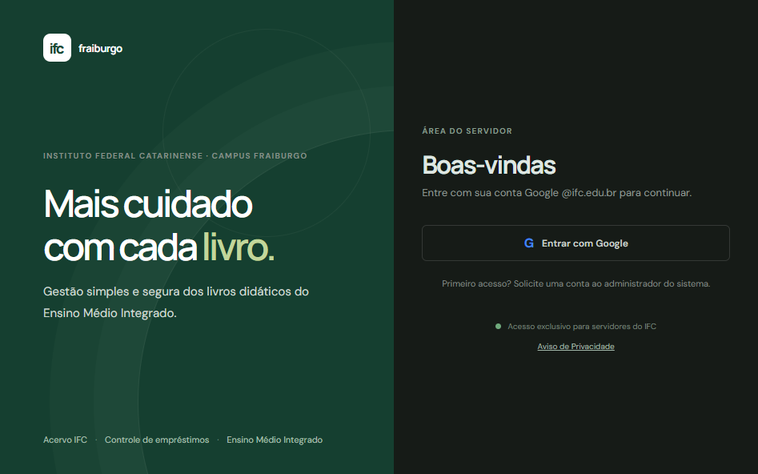
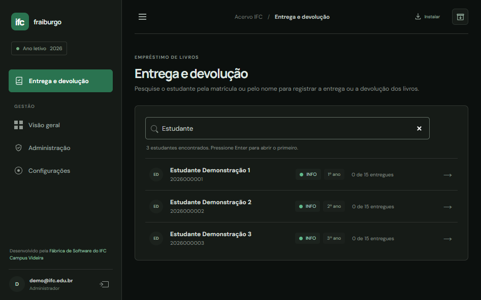
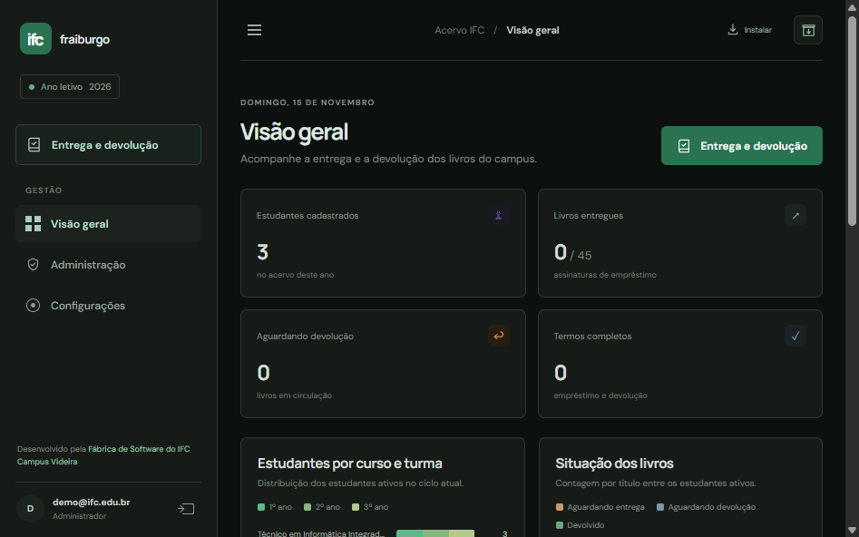

# Acervo IFC · Campus Fraiburgo

Aplicação para controlar a entrega e a devolução de livros didáticos no Ensino Médio Integrado do IFC. O termo de compromisso e as regras foram adaptados do [documento original](documentos/Termo%20de%20compromisso.pdf).

## Funcionalidades

- Cadastro e importação de estudantes, cursos e livros.
- Registro de entregas e devoluções com assinaturas, histórico e correções.
- Acompanhamento por ano letivo, turma e curso; exportação dos termos.
- Administração de usuários, backups e restauração do banco.
- Acesso de servidores somente pelo login com Google, com contas `@ifc.edu.br` já cadastradas.

## Telas

As imagens usam dados fictícios de demonstração.

**Login**



**Entrega e devolução**



**Visão geral**



## Como executar

### Com Docker Compose

Requisitos: Docker Engine e Docker Compose.

```bash
docker compose -f docker-compose.dev.yml up --build
```

Em outro terminal, cadastre o e-mail `@ifc.edu.br` de um servidor (o acesso será pelo Google; use `--admin` para administrador):

```bash
docker compose -f docker-compose.dev.yml run --rm web python server.py create-user
```

Acesse <http://localhost:5000>. Para encerrar, use `Ctrl+C` e:

```bash
docker compose -f docker-compose.dev.yml down
```

O código é montado no container e o Flask recarrega automaticamente por padrão. O banco de desenvolvimento fica em `data-dev/livros.db`, isolado da produção, e persiste após remover os containers.

Para apagar **todos os estudantes do banco de desenvolvimento**, voltar ao ano corrente e carregar três estudantes fictícios, execute o comando abaixo. As contas de servidores são preservadas:

```bash
docker compose -f docker-compose.dev.yml run --rm web python server.py reset-dev-data
```

O Compose lê o `.env` na raiz e as variáveis do ambiente, que têm precedência. `PORT` define a porta do Flask e, por padrão, a porta do host (padrão: `5000`); `HOST_PORT` permite usar outra porta no host. Também são aceitas `SECRET_KEY`, `COOKIE_SECURE`, `FLASK_DEBUG`, `SCHOOL_YEAR`, `SESSION_MAX_AGE`, `SESSION_IDLE_TIMEOUT`, `BACKUP_PATH` e as variáveis `GOOGLE_*`. `BACKUP_PATH` é um caminho dentro do container: use `/data` para persistir os backups. A chave padrão é exclusiva para desenvolvimento; para acesso por HTTP, mantenha `COOKIE_SECURE=false`, inclusive se o `.env` de produção usar `true`.

### Com Python

Requer Python 3.10 ou superior:

```bash
python -m pip install -r requirements.txt
python server.py create-user
python server.py
```

Acesse <http://127.0.0.1:5000>. O banco `livros.db` é criado no diretório do projeto. Sem `SECRET_KEY`, o `server.py` gera uma chave temporária e as sessões são encerradas a cada reinício.

## Uso e administração

- Em **Entrega e devolução**, pesquise um estudante por nome ou matrícula, abra o termo e registre as assinaturas. O histórico permite consultar e cancelar registros com justificativa.
- Administradores gerenciam estudantes, cursos, livros e contas em **Administração**. A importação de estudantes aceita CSV; use **Baixar modelo CSV** para obter os cabeçalhos e exemplos.
- Cada ano letivo tem seu próprio termo. O ano inicial usa `SCHOOL_YEAR` ou o ano corrente; após a inicialização, o ano salvo no banco prevalece. Antes de avançar o ano, o sistema cria e valida um backup.
- A conta `fabricio.bizotto@ifc.edu.br` recebe perfil de administrador ao ser criada. Não há senhas nem cadastro público: um administrador cadastra o e-mail e a pessoa entra com a conta Google desse e-mail.
- O login com Google é obrigatório: configure `GOOGLE_CLIENT_ID`, `GOOGLE_CLIENT_SECRET` e `GOOGLE_REDIRECT_URI`. A URI deve coincidir com a cadastrada no Google e terminar em `/api/auth/google/callback`. Só entram contas Google verificadas do domínio `ifc.edu.br` com cadastro ativo no Acervo.

## Produção e dados

O [Compose de produção](docker-compose.yml) usa Gunicorn atrás do Nginx e foi preparado para o Dokploy. Para configurar:

1. Crie um recurso Docker Compose no Dokploy apontando para este repositório, branch `main`, arquivo `docker-compose.yml`. Desative o deploy automático do Dokploy.
2. Na aba **Environment**, configure as variáveis do [.env.example](.env.example). `SECRET_KEY` é obrigatória; gere uma chave persistente com `python -c "import secrets; print(secrets.token_hex(32))"`.
3. Configure `DATA_DIR` e `BACKUP_DIR` como pastas persistentes fora do repositório. Os padrões são `/srv/fabrica-livros/data` e `/srv/fabrica-livros/backups`. Se já houver um banco, copie-o para `DATA_DIR/livros.db` antes do primeiro deploy.
4. Em **Domains**, configure o domínio com HTTPS para o serviço `nginx`, porta `80`. Mantenha `COOKIE_SECURE=true`.
5. Após o deploy, crie a conta inicial no terminal do container `web` com `python server.py create-user --admin` (o e-mail da sua conta Google `@ifc.edu.br`).

O [workflow de CI/CD](.github/workflows/ci-cd.yml) executa testes, auditoria de dependências, build e validação dos Compose. Para solicitar o deploy ao Dokploy após aprovação na `main`, configure os secrets `DOKPLOY_URL`, `DOKPLOY_API_KEY` e `DOKPLOY_COMPOSE_ID` no GitHub. Também é possível reimplantar pela opção **Run workflow**.

Backups manuais, de restauração e de avanço do ano ficam junto ao banco; o sistema mantém os cinco mais recentes. Em produção, o serviço `backup` cria cópias diárias em `BACKUP_DIR` (por padrão, 14 cópias, às 03:00 de Brasília). É possível restaurar um backup pela aba **Administração → Backup**; para as cópias diárias `.gz`, descompacte antes de enviar.

**Proteja os bancos e backups:** eles contêm dados pessoais, assinaturas e hashes de senha de contas antigas. Não os publique e mantenha cópias em outro local protegido. Antes de usar dados reais, o IFC deve validar o aviso de privacidade, definir a base legal e o prazo de retenção e atualizar o canal do encarregado. A validade jurídica das assinaturas também deve ser avaliada institucionalmente.

## Como contribuir

1. Abra uma issue para relatar problemas ou propor melhorias.
2. Crie uma branch a partir de `main` e faça alterações focadas.
3. Instale as dependências e execute os testes:

   ```bash
   python -m pip install -r requirements.txt
   python -m unittest -v test_app
   ```

4. Abra um pull request descrevendo a alteração e como foi testada. Não inclua dados reais, bancos, backups, senhas ou arquivos `.env`.

O projeto usa Flask e SQLite, organizado em camadas de controllers, serviços e repositório no diretório [acervo](acervo/).

## Desenvolvimento

Desenvolvido pela [Fábrica de Software do IFC Campus Videira](http://fabrica.videira.ifc.edu.br/). Consulte também os [contribuidores do projeto](https://github.com/FabSoftwareVideira/fabrica-livros/graphs/contributors).
